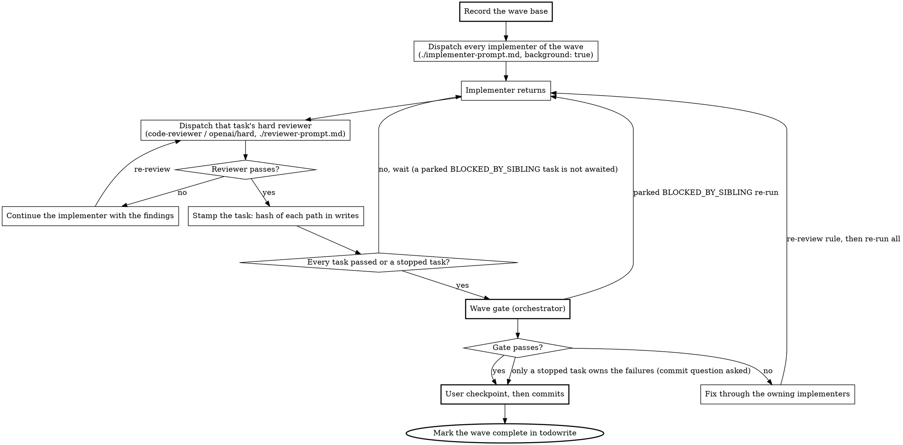

# Subagent-Driven Development

Implement an approved design by decomposing it into ordered tasks and grouping them into waves. Each task runs with an isolated subagent and a combined review, and the user checkpoint comes once per wave.

The iron-law rules (context isolation, git ownership, worktree ban, privilege ban) live in `../../rules/common/subagents.md`. The procedural rules that bind once this skill is dispatching subagents (subagent type selection, model selection, process discipline, escalation) live in `../_shared/subagent-dispatch.md` and apply throughout this skill. The rule that implementation requires an approved design lives in `../../rules/common/workflow.md`.

Before running the procedure below, you **MUST** read `../_shared/subagent-dispatch.md` using the Read tool if you have not already read it in this session.

## When to Run

You need an approved design (from the `brainstorming` router via any of its modes, including when `work-on-ticket` enters it, or from a committed specification) whose tasks are mostly independent of each other. If the work is tightly coupled or the design is incomplete, return to brainstorming instead of running this skill.

## Plan File

If the approved design was saved to a plan file under `/Users/jose.romero/.opencode/plan/`, read the design from that file. Give every subagent that path. Tell it to read the design from the file instead of pasting the design into the prompt. Still paste each task's own scope, context and acceptance criteria into its prompt.

## Process Overview

1. Settle the commit preference and record the prune base (once, at the start of the session)
2. Run `complexity-triage` against the design
3. If SIMPLE: hand off to `fast-path-implementation` and stop
4. If COMPLEX: decompose into tasks, group them into waves, and execute the per-wave pipeline for each wave
5. When all waves are complete, run the feature test prune, then the final feature-level review and verification, then report completion

A wave is a set of independent tasks that run together in the same working tree. A sequential run is waves of one task. Worktrees stay forbidden.

## Commit Preference

If `git rev-parse --is-inside-work-tree` fails, the working directory is not a git repository. In that case you **MUST** follow `../_shared/no-git-flow.md` in place of every git step in this skill. A non-git project always runs waves of one task.

Otherwise, before any further work, run `git rev-parse --path-format=absolute --git-dir --git-common-dir` once. It needs git 2.31 or later and prints both absolute paths, one per line. Compare them. If the command fails or gives unexpected output, ask as in the main worktree.

If the two paths differ, the session is in a linked worktree. Choose "Auto-commit after each wave" without asking. Announce the choice in one line, for example "Linked worktree: auto-commit after each wave."

If the two paths are equal, the session is in the main worktree. Ask the user how commits should be handled using `question`:

- **Auto-commit after each wave**: the orchestrator commits each task of a wave automatically after the wave gate passes. The user sees a summary of the changes but is not asked whether to commit, unless a stopped task leaves the checks red.
- **Ask me each time**: the orchestrator pauses after each wave and asks whether to commit.

Ask this once. The choice applies to every wave in the session, including any fast-path handoff. If the user chose auto-commit, the checkpoint still shows a summary of the changes. It skips the commit question unless a stopped task leaves the checks red.

Alongside the commit preference, record the prune base for the feature test prune. Record it exactly as "Before the First RED" in `../test-driven-development/SKILL.md` defines it. In the no-git flow, the base is `FEATURE_BASELINE_DIR`. The touched-file list is then every path named in the lines that `diff -rqN "$FEATURE_BASELINE_DIR" "$WORKING_DIR"` prints. Each line names two paths. Take the `$WORKING_DIR` path of each line. Leave out files that exist only in `$FEATURE_BASELINE_DIR`, because they are deleted.

## Triage and Path Selection

Run `complexity-triage` against the approved design. Present the evidence table to the user.

- If the classification is **SIMPLE**, invoke `fast-path-implementation` and stop. That skill owns the rest of the flow. Its single implementer and single review are a wave of one.
- If the classification is **COMPLEX**, continue with the task decomposition below.

## Task Decomposition

Before implementation, the parent sends the complete approved design, triage evidence, constraints, and relevant context to `stack-planner` on `openai/hard` for substantive file-structure decisions, task decomposition and wave assignment. The planner returns an ordered proposal with exact files, dependencies, acceptance criteria, a wave number, and a recommended agent role and required alias for each task. It does not ask the human, seek approval, or launch workflows. The parent owns the final decomposition, checks it against the approved design, and obtains any required user decisions before dispatch. If `stack-planner` is not used, the parent assigns waves with the rules below.

The six-criterion complexity triage selects the workflow, not each task's model. Workflow COMPLEX is not model difficulty: a complex feature may have bounded implementation tasks for `stack-specialist` on `openai/easy`. Route genuinely difficult approved implementation to `complex-worker` on `openai/hard`. Every independent implementation review uses a hard reviewer.

Each task has its own implementer role. If the planner is unsure which role fits, the task goes to `complex-worker`. One wave can mix both roles. Easy tasks stay on `openai/easy` because the slowest task sets the length of a wave.

### File Structure

Review the planner's proposed file map and responsibilities against the approved design, then lock the task scope before implementation. Each file should have one clear responsibility with a well-defined interface (see `../../rules/common/code-organisation.md`). In existing codebases, follow established patterns. Files that change together should live together.

### Task Granularity

Each task is a self-contained unit of work that produces working, testable code:

- Touches a focused set of files (ideally 1-3)
- Has clear acceptance criteria derivable from the design
- Can be verified independently of other tasks

Within each task, implementers follow the TDD cycle in `skills/test-driven-development/`. That detail is communicated in the implementer's dispatch, not tracked by the orchestrator.

### Task Ordering

Order tasks to respect dependencies:

1. Foundation and infrastructure first, including interfaces that feature tasks share
2. Core features next
3. Integration after dependencies
4. Polish and clean-up last

The foundation wave runs first and the integration wave runs last. In the middle, each task joins the earliest wave after the waves that hold its dependencies. Waves run in order. The tasks inside one wave run together.

### Wave Formation

Each task declares `writes` (exact paths, with tests and fixtures included), `produces` (outputs that other tasks use) and `consumes` (outputs that it needs). The orchestrator checks that the `writes` of a wave are disjoint before dispatch.

Two tasks share a wave only if all of these hold:

- Their `writes` are disjoint.
- Neither writes a generated, single-writer or append-to-shared file. Examples are proto output, migrations, lockfiles, manifests such as `composer.json` or `package.json`, registries, service providers, routes, and appends to barrels, enums or translations. Those tasks go to the foundation wave, the integration wave or a wave of their own.
- Neither consumes an output of the other.
- They share no test resource that lacks per-run isolation. A per-run isolated suite such as `just api test` is fine.
- They do not write to the same Go package or the same Rust crate, because one compiles the half-edited files of the other.

If you are unsure whether two tasks can share a wave, put them in separate waves.

A wave holds at most 4 implementers. Split a wider wave in plan order.

### Task Tracker Output

Before the first dispatch, write the whole wave plan in one `todowrite` call. Use the wave layout of the `todo-lists` skill:

- One parent per wave: `W1. Wave 1: <short goal>`
- One child per task: `└─ 1.1 <task name>`
- A last child per wave: `└─ 1.N Gate, checkpoint and commits`

Each `content` is one short line that names the task. It carries no details.

Put the task record in the plan file when one exists (see "Plan File"). Otherwise keep it in your own notes. The record keeps these fields:

- Task name and description
- Wave number
- Recommended agent role and required alias (selected per `../_shared/subagent-dispatch.md`)
- `writes`, `produces` and `consumes`
- Acceptance criteria
- Dependencies on other tasks
- Scene-setting context describing where the task fits in the overall design

Mark each task child `in_progress` when its implementer is dispatched. Mark it `completed` when its reviewer returns `[PASS]`. The `todo-lists` skill owns the remaining status rules.

If `todowrite` is not available, keep the same layout as a numbered checklist in your replies.

## Per-Wave Pipeline

Execute waves in order. Each wave follows the same pipeline.



1. **Record the wave base** before dispatch. Record `git rev-parse HEAD` and the `git status --porcelain -uall` list. Record the `git hash-object` of each already-dirty path. Copy each already-dirty file into the scratch directory. The copies let reviewers diff files that an earlier wave left dirty.
2. **Dispatch** every implementer of the wave in one message with `background: true`. Wait for the completion notices without polling. A wave of one follows the same rule.
3. **Review as each returns.** When an implementer returns `DONE` or `DONE_WITH_CONCERNS`, dispatch that task's `code-reviewer` on `openai/hard` in the background without waiting for siblings. Give the reviewer the inputs listed in `./reviewer-prompt.md`. On `[FAIL]`, continue the same implementer through `sessionID`, then review the task again. On `[PASS]`, record the `git hash-object` of every path in the task's `writes` as its approval stamp.
4. **Re-review rule.** Before the checkpoint, review a task again only if the hash of any path in its `writes` differs from its approval stamp. A gate fix, an "Adjust first" round or a sibling-unblock re-run can cause the change. The re-review receives the full task diff. A task in `BLOCKED_BY_SIBLING` is not reviewed until it reaches `DONE`.
5. **Run the wave gate** once every task that is not parked has a reviewer `[PASS]` or is a stopped task. Park a task in `BLOCKED_BY_SIBLING` and leave it for gate step 1. If a task cannot pass review, surface it to the user. It becomes a stopped task when the user chooses to leave it uncommitted. Otherwise, continue the task through its implementer.
6. **Checkpoint** once per wave, then commits.
7. **Start the next wave** only after the checkpoint is resolved and you have recorded a new base.

## Wave Gate

After every task that is not parked or stopped has passed review and **before** the user checkpoint, the orchestrator **MUST** run the wave gate. This is the "trust but verify" step that `../../rules/common/verification.md` requires when accepting any subagent's success report. The reviewers read the code. The orchestrator confirms the artefacts. The gate applies the gate function from the `verification-before-completion` skill to the wave. A parked `BLOCKED_BY_SIBLING` task enters the gate unreviewed, and step 1 resolves it.

1. **Resolve `BLOCKED_BY_SIBLING`** once every task that is not parked has a reviewer `[PASS]` or is a stopped task. This step also runs when every remaining task is parked. Continue each parked child once through `sessionID` with "siblings complete, re-run". The re-run child goes through the review step before the gate continues at step 2. If the child reports it again, the second `BLOCKED_BY_SIBLING` becomes an ordinary `BLOCKED`.
2. **Build the touched list.** Combine three sets of paths. The first is `git diff --name-only <wave-base>`, which includes deletions. The second is the untracked files from `git status --porcelain -uall`. The third is the already-dirty files whose `git hash-object` differs from the wave base. A path already dirty or untracked at the wave base counts as touched only if its `git hash-object` differs from the recorded one. This holds for all three sets. The TDD skill's recipe hides deletions, so the gate states its own command.
3. **Attribute each touched path** to the one task whose `writes` contain it. If a path is in no task's `writes`, stop the gate. Show the path and its diff. Ask the user to assign it to a task or discard it. Never revert on your own. If no task touched a declared test path, send it to the reviewer of the task that declared the path, as a probable missing test.
4. **Confirm the TDD evidence.** Each implementer report **MUST** contain RED to GREEN evidence per `./implementer-prompt.md`. If it does not, continue that implementer through `sessionID` with a request for the missing evidence. You **MUST NOT** wave it through.
5. **Run the whole-project checks** yourself, in this message, for each pillar that the wave touched. Run them once, one after another, never in parallel. For example, run `just api check`, then `just api test`. If the task specs name other verification commands, run those as well. Do not rely on the implementers' claimed results. Capture exit codes and pass/fail counts.
6. **Fix a failure in a file that one task wrote.** Use that task's implementer, even if the problem predates the wave. Skip a stopped task, as step 9 states. Continue the owners through `sessionID` with the exact output, in parallel if several own parts. Apply the re-review rule, then re-run the whole gate, because evidence must be fresh after the last change. Do not patch the issue in the orchestrator context, because that pollutes context and defeats `../../rules/common/subagents.md`.
7. **Surface a failure that no single task owns** to the user with the failing output and the candidate tasks. Examples are a file that the wave did not touch, or a mismatch between two tasks over a foundation interface that no task changed. Send a failure traced to a stopped task's files to step 9 instead. Do not guess an owner. The user can direct a fix as a new single-task wave.
8. **Limit the fix loop.** If the same task fails the gate twice on the same check, surface it to the user. If a gate command times out, re-run that command once on its own. If it times out again, report an environment failure to the user. A timeout never re-dispatches an implementer.
9. **Report a stopped task's failures.** A failure owned by a stopped task is reported at the checkpoint, not fixed. It does not block the commits of the passing tasks. This includes a failure in a passing task's check that traces to a stopped task's files.

The gate output (commands run, exit codes, pass/fail counts) is shown to the user at the checkpoint. "The reviewer said it was fine" is not a substitute for the gate.

## User Checkpoint

After the wave gate passes, present one checkpoint for the wave. Present it also when the gate reports only failures owned by a stopped task. For each task show the summary, the reviewer verdict, the implementer's TDD RED to GREEN evidence and the task's own diff. Then show the wave gate commands with their exit codes and pass/fail counts. If the user stopped a task, the whole-project checks stay red until the stopped task is resolved. The gate evidence is non-optional, because without it you have not satisfied `../../rules/common/verification.md`.

If the session's commit preference is "Ask me each time", use one `question` for the wave with the options "Commit all tasks", "Adjust first" and "Skip commit". Commit only when the user chooses "Commit all tasks". A stopped task stays uncommitted.

If the session's commit preference is auto-commit, commit right after you present the summary, unless a stopped task leaves the checks red. In that case you **MUST** ask the commit question even under auto-commit.

**Adjust first.** Map the user's request to tasks by path. Continue the owners through `sessionID`, in parallel when their `writes` are disjoint. Apply the re-review rule, re-run the gate, and ask the same question again. If the request needs a path outside every `writes`, ask the user which task gets it, or run it as a new single-task wave. A new single-task wave runs the full pipeline, including its own checkpoint.

**Commits.** Make one commit per task, in plan order. Stage the task's touched paths with `git add -A -- <paths>`, which includes deletions. Commit with `git commit -m "<subject>" -- <paths>`, so that anything the user had staged stays out of the commit. Use the existing message conventions. Never use `-a` and never use `--no-verify`. If a commit hook fails, stop and report which tasks were committed and which were not. After the last commit, `git status --porcelain -uall` must show no path that the wave touched.

**Skip commit.** Path staging cannot split hunks, so a later task that writes a path left uncommitted would commit both changes together. The checkpoint warns when a later wave's `writes` overlap such paths. It also flags a file that was dirty before the wave and that a task changed.

If the user leaves one task uncommitted and the rest pass, the passing tasks commit. The stopped task stays uncommitted and the checkpoint lists it.

## Handling Implementer Status

Implementer subagents report one of five statuses:

- **DONE**: proceed to review
- **DONE_WITH_CONCERNS**: read the concerns. If they are about correctness or scope, address them before review. If they are observations ("this file is getting large"), note them and proceed to review. If the implementer reports a duplicate that it must extract outside its `writes`, schedule an extraction task in a later wave. If no later wave exists, run it in a new final wave after the integration wave.
- **NEEDS_CONTEXT**: answer as each notice arrives and continue the child through `sessionID` in the background. Siblings keep running. If the answer needs the user, ask one question while siblings run. If the answer adds a path to `writes`, check that the path is disjoint from every sibling's `writes`. If it is not disjoint, surface the plan change to the user.
- **BLOCKED_BY_SIBLING**: the report names the command, quotes the error line that names a file, and states that the file is outside the task's `writes`. Do not review the task yet. Resolve it at the wave gate. If the file is in no sibling's `writes`, or the wave has one task, treat the status as an ordinary `BLOCKED`.
- **BLOCKED**: assess the blocker. If it is context, provide the missing context. If the approved task is genuinely difficult, narrow it or route it to `complex-worker` on `openai/hard`. Do not retry on a cheaper role first. If the task is too large, break it into smaller pieces. If the plan itself is wrong, stop and surface to the human per `../../rules/common/workflow.md`.

If an implementer reports that its task is harder than expected, dispatch the task again to `complex-worker` as a new child in the same wave. The brief says that the earlier partial edits in its `writes` are still in the tree. `sessionID` continues a child only in the same role, so do not use it for this.

Every report carries an "Environment failures" field. A timeout is never RED or GREEN evidence. The implementer retries once, and the orchestrator re-runs the command serially at the gate.

The rules in `../_shared/subagent-dispatch.md` forbid ignoring an escalation or forcing the same model to retry without changing anything.

## Feature Test Prune

After the last wave's checkpoint, run the PRUNE stage of `../test-driven-development/SKILL.md` once for the whole feature. Implementers do not prune. The prune covers every touched file of the feature since the prune base that you recorded at session start.

- If there is no touched test file, skip the prune and say so in the completion report. In the no-git flow, this applies when `diff -rqN` reports no test file.
- If the audit has no REMOVE and no MERGE, nothing changes and nothing is asked.
- If the user approves one or more REMOVE or MERGE, apply them as the PRUNE procedure says. Then re-run the project's full test command and linter, and cite the output.
- If that re-run passes, commit the removals and merges as one extra commit under the session's commit preference. Under auto-commit, commit without asking. Under "Ask me each time", ask one commit question. Follow the path-limited commit rules of `## User Checkpoint`.
- If that re-run fails, restore the removed tests from the restore record, drop the assertions that each MERGE added, and report the failure. Then continue to the final review without the removals.
- If the audit reports an uncovered behaviour, write its test in a new single-task wave through an implementer. The wave uses the full per-wave pipeline: review, gate, checkpoint, and commit under the session's commit preference. The orchestrator does not write the test itself. Then audit again with `[SCOPE]` limited to the tests that wave added. Handle the results of that audit under the bullets above, and treat the prune as resolved when it ends.

## Final Feature-Level Review

After every wave has run, every task must be committed or set aside per the user's preference. Then you **MUST** run a final feature-level review against the cumulative work range. Do this before you report the feature complete. The task reviewers see one task at a time. The final review sees the feature as a whole. It catches issues that only emerge across task boundaries (inconsistent naming, drifting interfaces, integration gaps, leaked test scaffolding).

The procedure:

1. **Identify the feature range.** Capture it only after the feature test prune is resolved, so that the review sees the pruned diff. Capture the base commit (`HEAD` at session start) and the head commit (current `HEAD`). Include the uncommitted diff of any skipped waves. Also include any prune removals left uncommitted because the user declined the extra prune commit.
2. **Check the wave bookkeeping.** Every extraction task scheduled from a duplicate report ran and was committed. No `DONE_WITH_CONCERNS` item is left unresolved. The `git show --name-only` of each task commit is a subset of that task's `writes`. Every task's declared tests exist.
3. **Invoke `requesting-code-review`** against that range. It dispatches `code-reviewer` on `openai/hard` using `skills/requesting-code-review/code-reviewer.md`, with the complete diff and verification evidence. This is the production-readiness review mandated by `../../rules/common/code-review.md`. The task reviews do not replace it.
4. **Process the reviewer output via `receiving-code-review`.** Apply severity discipline per `../../rules/common/code-review.md`:
   - **Critical** issues: stop and fix before reporting completion. Continue the implementer for the affected task scope in a new single-task wave. Run the full pipeline including the wave gate, then re-run the feature-level review.
   - **Important** issues: same as Critical for orchestrated work. Fix before completion.
   - **Minor** issues: log them in the completion report. The user decides whether to address them in this session or later.
5. **Run `verification-before-completion`** against the feature range. The wave gates verified each wave in isolation. This final pass verifies the feature as a whole. Run the project's full test suite, the linter, the build, and any feature-specific verification the design called out. Cite the output.
6. **Report completion** with: the list of tasks completed, the feature-level review verdict, the verification commands and their outputs, and any deferred Minor issues.

You **MUST NOT** report the feature complete without steps 3 and 5 having been run in this message. The wave gates do not satisfy `../../rules/common/verification.md` for the feature claim. Only a fresh feature-level run does.

The wording of this skill cannot prove the behaviour of a parallel run. The first real parallel run is the true check, and you report its result to the user.

## Worked Example

```
You: I'm using Subagent-Driven Development to implement this design.

[git-dir equals git-common-dir: main worktree, ask user: commit preference]
User chose: Ask me each time
[Record the prune base]

[Run complexity-triage]
Classification: COMPLEX

[Decompose: 3 tasks, 2 waves]
Wave 1: Task 1 (install-hook command) and Task 2 (verify/repair modes)
  writes are disjoint, neither consumes the other, both stack-specialist / openai/easy
Wave 2: Task 3 (register both commands in the CLI entry point), integration wave of one

[Wave 1: record base, dispatch both implementers in one message with background: true]
Implementer 2 returns DONE first.
[Dispatch code-reviewer / openai/hard for Task 2 without waiting]
Reviewer: [FAIL] missing progress reporting.
[Continue implementer 2 through sessionID]
Implementer 1 returns DONE.
[Dispatch code-reviewer for Task 1]
Reviewer: [PASS]
[Task 2 fixed, reviewed again] Reviewer: [PASS]

[Wave gate: touched list matches both tasks' writes]
$ just cli check
exit 0
$ just cli test
exit 0 (78 passed)

[Checkpoint: both summaries, verdicts, TDD evidence, diffs, gate output]
[Ask: Commit all tasks / Adjust first / Skip commit]
User: Commit all tasks
[Commit Task 1, then Task 2, each limited to its own paths]

[Wave 2: record base, dispatch implementer 3, review, gate, checkpoint, commit]

[Feature test prune: the audit has no REMOVE and no MERGE, so nothing is asked]

[Final feature-level review: requesting-code-review, then verification-before-completion]

Done.
```

## Prompt Templates

- `./implementer-prompt.md`: the implementer prompt used by this workflow and `fast-path-implementation`
- `./reviewer-prompt.md`: dispatch the combined reviewer subagent for each task review

## Integration

- **brainstorming** (and its mode skills `brainstorming-standard`, `brainstorming-committee`, `brainstorming-skip`): produces the design this skill implements
- **work-on-ticket**: recovers context from tickets in new sessions and hands it to the `brainstorming` router, which produces the design this skill implements
- **complexity-triage**: invoked at the start to classify the work
- **fast-path-implementation**: receives SIMPLE work handed off from this skill
- **test-driven-development**: the cycle every implementer subagent follows for each task
- **requesting-code-review**: for the code review prompt used by reviewer subagents
