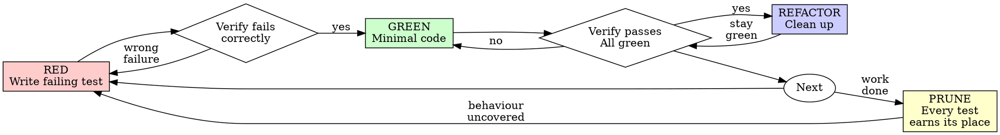

# Test-Driven Development

This skill executes the red-green-refactor cycle. The iron-law rules (the iron law itself, when TDD applies, the verification requirement, YAGNI during GREEN, good-test criteria) live in `../../rules/common/testing.md` and apply throughout. The procedural rules that bind once this skill is running (the rationalisation table, the red-flags stop list) live in `RULES.md` alongside this file.

Before running the cycle below, you **MUST** read `RULES.md` (sibling file in this skill directory) using the Read tool if you have not already read it in this session.

Before the PRUNE stage, you **MUST** read `../_shared/subagent-dispatch.md` and `auditor-prompt.md` (sibling file in this skill directory) using the Read tool if you have not already read them in this session.

## The Cycle



## Before the First RED: Record the Base

Before the first RED of a piece of work, you **MUST** record three things. First, record the base commit with `git rev-parse HEAD`. Second, record the files that `git status --porcelain -uall` already shows as changed. The `-uall` flag matters because without it git collapses an untracked directory into one entry and hides the files inside it. Third, record the `git hash-object` of each of those already-changed files. The prune uses these records to find the files this work touched. If the project is not a git repository, the base cannot be recorded. The cycle proceeds normally, and at the prune you ask your human partner for the touched-file list. Inside an orchestration, the orchestrator uses the prune base that the orchestrator recorded instead of asking.

## RED: Write a Failing Test

Write one minimal test that expresses the behaviour you want. Name it as a complete phrase describing the behaviour. Exercise real code.

<Good>
```typescript
test('retries failed operations 3 times', async () => {
  let attempts = 0;
  const operation = () => {
    attempts++;
    if (attempts < 3) throw new Error('fail');
    return 'success';
  };

  const result = await retryOperation(operation);

  expect(result).toBe('success');
  expect(attempts).toBe(3);
});
```
</Good>

<Bad>
```typescript
test('retry works', async () => {
  const mock = jest.fn()
    .mockRejectedValueOnce(new Error())
    .mockRejectedValueOnce(new Error())
    .mockResolvedValueOnce('success');
  await retryOperation(mock);
  expect(mock).toHaveBeenCalledTimes(3);
});
```
Vague name, and it tests the mock rather than the code under test.
</Bad>

## Verify RED: Watch It Fail

Run the test:

```bash
npm test path/to/test.test.ts
```

Confirm:

- The test fails (it does not error)
- The failure message is the one you expected
- The failure is because the feature is missing, not because of a typo or import error

If the test passes, you are exercising behaviour that already exists. Fix the test.
If the test errors, fix the error and re-run until the test fails for the right reason.

## GREEN: Minimal Code to Pass

Write the simplest code that makes the test pass.

<Good>
```typescript
async function retryOperation<T>(fn: () => Promise<T>): Promise<T> {
  for (let i = 0; i < 3; i++) {
    try {
      return await fn();
    } catch (e) {
      if (i === 2) throw e;
    }
  }
  throw new Error('unreachable');
}
```
</Good>

<Bad>
```typescript
async function retryOperation<T>(
  fn: () => Promise<T>,
  options?: {
    maxRetries?: number;
    backoff?: 'linear' | 'exponential';
    onRetry?: (attempt: number) => void;
  }
): Promise<T> {
  // YAGNI
}
```
Over-engineered. The test did not ask for options.
</Bad>

## Verify GREEN: Watch It Pass

Run the test:

```bash
npm test path/to/test.test.ts
```

Confirm:

- The new test passes
- All other tests still pass
- Output is pristine, no warnings, no stray errors

If the new test fails, fix the code, not the test.
If other tests fail, fix them now before continuing.

## REFACTOR: Clean Up While Green

Only once the test is passing:

- Remove duplication
- Improve names
- Extract helpers

Keep every test green throughout. Do not add new behaviour during refactor.

## Repeat

Write the next failing test for the next piece of behaviour.

Once the last behaviour of the piece of work is green and refactored, run PRUNE. Inside `debugging` Phase 7, the work is green only after the fix. So the prune runs once, at Phase 7's prune step, and not when Phase 7's RED step ends.

Inside an orchestrated implementation (`subagent-driven-development` or `fast-path-implementation`), the orchestrator runs the PRUNE once for the whole feature, before the final review. An implementer subagent does not run it.

## PRUNE: Every Test Earns Its Place

Prune once, after the last behaviour of the piece of work is green and refactored. The prune comes before the Completion Gate and any review. Each cycle justified one test against one behaviour, but together the tests overlap. Common examples are a second case from the same input class and an assertion on incidental structure. Others are a test of a mock and a test of a helper extracted during REFACTOR. A test that catches no defect another test misses costs maintenance and protects nothing. The prune applies to bug fixes under the same rules, so a regression test earns its place like any other test.

### Scope

The prune covers every test in every touched file, whether this work added the test or it existed before. A touched file is one changed since the recorded base, and that includes a production file whose inline test module changed. Files that were already changed at the base are excluded unless this work edited them. "Tests" means test files and in-file test modules of production files. Production code without tests is read only as the code the tests exercise. Test files the work did not change, and deleted files, are out of scope. Report any over-testing noticed there to your human partner in a separate list.

### Procedure

1. **Build the touched-file list.** Take the union of two sets. The first set holds the files in `git diff --name-only --diff-filter=d <base>` and the untracked files in `git status --porcelain -uall` that were not already changed at the base. The second set holds the files already changed at the base whose `git hash-object` now differs from the recorded one. If the project is not a git repository, ask your human partner for the touched-file list instead. The exception is an orchestration that keeps a feature baseline under the no-git flow. There, use every path that `diff -ruN "$FEATURE_BASELINE_DIR" "$WORKING_DIR"` reports instead of asking.
2. **Dispatch the auditor.** Fill every placeholder of `auditor-prompt.md`. Dispatch it through the native OpenCode V2 subagent interface with `agent: code-reviewer`. The `code-reviewer` agent runs on `openai/hard`. Set `description` to `Test audit: <what was built>` and `prompt` to the filled text. Run the call in the foreground, and omit `background` and `sessionID`. Pass no session history. The routing rule in `../../rules/common/model-routing.md` sends every independent implementation review to `code-reviewer` on `openai/hard`, and tests are implementation code. If the auditor returns `NEEDS_CONTEXT`, supply the gap and continue that same child with its `sessionID`. If `code-reviewer` is unavailable, the run is `BLOCKED`: stop and tell your human partner. Audit the tests yourself only with your human partner's explicit authorisation, and report the result as a self-audit.
3. **Check each surviving test.** Every REMOVE names a surviving test. A REMOVE is valid in three cases. Its survivor is a KEEP in the same audit, a test outside that audit's `[SCOPE]`, or `none` because the removed test cannot fail. If a REMOVE fails this check, treat it as KEEP. A test in scope that the audit does not mention is treated as KEEP and flagged in step 4.
4. **Present the results to your human partner before continuing.** This step is mandatory. Show the full audit before you apply any removal. Show every REMOVE, numbered, with its surviving test and the shared defect. Show every KEEP with the defect that only it catches. Show each REMOVE that step 3 turned into a KEEP, with the reason. Show any test you want to keep against the auditor's verdict, with the defect that only that test catches. Show the uncovered behaviours and the outside-scope observations. Then ask with the native `question` tool, offering exactly these options: `Apply all removals`, `Choose which to apply`, `Apply none`. On `Choose which to apply`, ask a follow-up for the REMOVE numbers to apply, with a second `question` or a plain-text request. Apply nothing until that reply arrives, and treat every unlisted REMOVE as a KEEP by your human partner's decision. After the answer, any approved REMOVE whose surviving test is also approved for removal becomes a KEEP. Say which before deleting anything. Remove nothing until your human partner answers. If there is no REMOVE, present the audit and ask nothing.
5. **Apply the approved removals.** Remove test cases, never files: deleting a tracked file is destructive under `../../rules/common/git.md`. If the removals would leave a file with no tests, keep its last test and tell your human partner. Before removing, post one message that records, for each approved removal, the file path, the test name and the test's full source. That message is the restore record.
6. **Return to RED for an uncovered behaviour.** If the auditor reports a behaviour with no test, write its failing test and run the cycle. Then return to step 2 and audit again, with `[SCOPE]` set to only the tests added since the previous audit. That audit also goes through steps 3 and 4. Inside an orchestration, the orchestrator does not write the test. It runs the test as a new single-task wave through an implementer, as `subagent-driven-development` describes.
7. **Verify GREEN.** Run the full suite and confirm that every test passes with pristine output. If the suite is red after the removals, restore each removed test from the restore record, touch nothing else, and report. Never use `git restore`.

## Worked Example: Bug Fix

**Bug:** Empty email accepted.

**RED**

```typescript
test('rejects empty email', async () => {
  const result = await submitForm({ email: '' });
  expect(result.error).toBe('Email required');
});
```

**Verify RED**

```bash
$ npm test
FAIL: expected 'Email required', got undefined
```

**GREEN**

```typescript
function submitForm(data: FormData) {
  if (!data.email?.trim()) {
    return { error: 'Email required' };
  }
  // ...
}
```

**Verify GREEN**

```bash
$ npm test
PASS
```

**REFACTOR**
Extract validation for multiple fields if the pattern repeats.

## Completion Gate

Before claiming a cycle complete, confirm every box:

- [ ] Every new behaviour has a test
- [ ] You watched each test fail before implementing
- [ ] Each test failed for the expected reason, not a typo or import error
- [ ] You wrote only the minimal code to pass each test
- [ ] All tests pass
- [ ] Output is pristine
- [ ] Tests exercise real code, mocks only at true boundaries
- [ ] Edge cases and error paths covered
- [ ] The prune ran, and its audit was presented to your human partner. A decision is required only when there is a REMOVE. Every remaining test in the touched files names a defect only it catches, or was kept by your human partner's decision or the last-test rule. Inside `debugging` Phase 7, this box is checked at Phase 7's prune step, after the fix. Inside `subagent-driven-development` or `fast-path-implementation`, the orchestrator checks this box at the feature test prune, and an implementer leaves it to the orchestrator.

If any box is unchecked, you skipped part of the cycle. The rules in `../../rules/common/testing.md` apply.

## When Stuck

| Problem                   | Response                                                                     |
|---------------------------|------------------------------------------------------------------------------|
| Don't know how to test it | Write the wished-for API. Write the assertion first. Ask your human partner. |
| Test is too complicated   | The design is too complicated. Simplify the interface.                       |
| Must mock everything      | Code is too coupled. Use dependency injection.                               |
| Test setup is huge        | Extract helpers. If still complex, simplify the design.                      |

## Testing Anti-Patterns

When adding mocks or test utilities, read `testing-anti-patterns.md` to avoid:

- Testing mock behaviour instead of real behaviour
- Adding test-only methods to production classes
- Mocking without understanding dependencies
